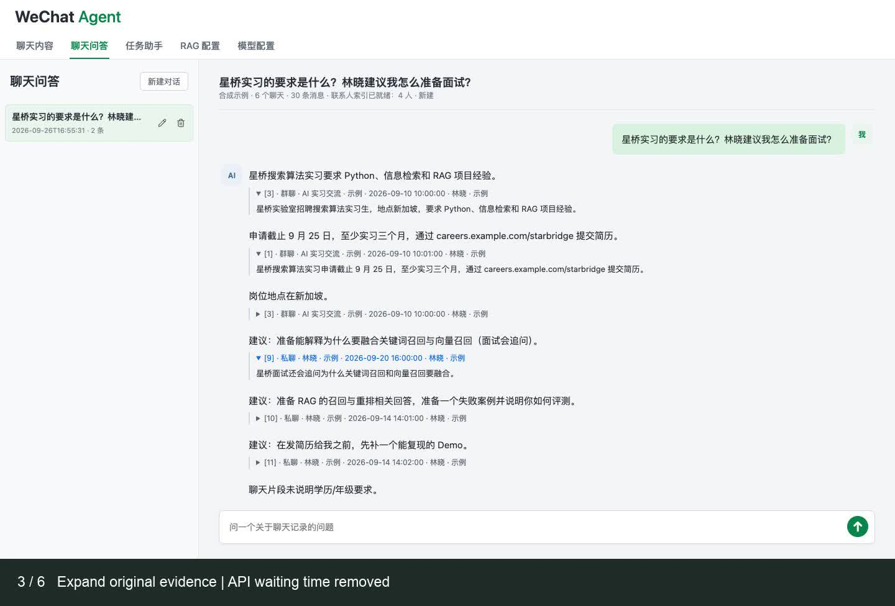

# Watch or Run the Demo

[Project overview](../README.md) | [中文项目介绍](../README.zh-CN.md)

## Watch the 77-Second Walkthrough

[](demo/wechat-agent-demo.mp4)

[Play or download the MP4](demo/wechat-agent-demo.mp4).
English explanation captions, Chinese interface, no audio; 1440 × 976, H.264.

| Time | Scene |
|---|---|
| 00:00–00:10 | Browse group and private chats |
| 00:10–00:20 | Ask one question across conversations |
| 00:20–00:34 | Expand original group/private evidence |
| 00:34–00:47 | Create a daily task with a 30-day lookback and run it |
| 00:47–00:58 | Inspect the real task result and follow-up suggestions |
| 00:58–01:07 | Import ten new fictional messages, taking the corpus from 30 to 40 |
| 01:07–01:17 | Click incremental update and inspect the ten inserted messages |

Recorded on September 26, 2026 using real UI interactions and live
`gpt-5-mini` Q&A/task calls. No model answer was authored or substituted. Waiting
time between submission and model completion is omitted and labeled. The task
is scheduled daily and triggered manually for this take; the video does not
pretend that a day elapses during recording.

This is a historical recording, not a recording of the latest Skill editor.
Current tasks use editable Python Skill packages that must pass isolated tests
before execution. Follow the current walkthrough below for that workflow.

This take uses local lexical retrieval and a full-text index, with embedding
and reranking disabled. The sample append is performed by the recording
helper, not a claimed production import button. The helper's append endpoint
exists only in its temporary demo server, not the normal application.

## Try It Yourself

This optional path runs the same application with the 40 authored messages in
`examples/chats.json`. It needs neither a WeChat installation nor database
keys. It is useful for exploring the UI or recording a demonstration without
exposing private conversations. It does not test real-client key extraction.

## Prepare the Environment

From the repository root:

```bash
python3 -m venv .venv
source .venv/bin/activate
python -m pip install -r requirements.txt
```

## Import and Index

```bash
python -m wechat_agent.demo init --root .demo/showcase
python -m wechat_agent.demo index --root .demo/showcase
python -m wechat_agent.demo append --root .demo/showcase
python -m wechat_agent.demo index --root .demo/showcase
```

The first import contains 30 messages. The append adds 10, and the second index
update processes the additions. Repeating the append or index does not duplicate
messages. Each command must use the same root.

The demo refuses to overwrite a nonempty directory without its demo marker.
Use a new empty directory for a fresh run; never remove private data to reset it.

## Open the Application

```bash
python -m wechat_agent.demo serve --root .demo/showcase
```

Open [http://127.0.0.1:8787](http://127.0.0.1:8787). If that port is occupied,
the command exits instead of taking over the running service or opening another
port. Stop it with Ctrl+C. Automatic syncing from real WeChat is disabled.

Browse the six conversations, inspect the index, and try retrieval debugging.
The demo includes no credentials. Browsing and text indexing work offline;
hybrid search requires Embedding and Rerank configuration. Chat Q&A and task
generation also need model services: configure their independent profiles in the
demo's **Model Settings** page. This can incur provider charges; only sample
messages should be used. Never record or publish the credential fields.

All demo settings and generated history stay beneath the selected root
(model settings here are `.demo/showcase/models.json`).
No private source directory or existing model configuration is used as fallback.

## Suggested Walkthrough

1. Import and index the initial sample, then browse a private and a group conversation.
2. Ask which search/RAG internships were shared in Singapore; follow up about
   application requirements in the same Q&A conversation.
3. Expand the original sources to distinguish a group posting from private
   interview advice. Inspect the tool trace to see how the model retrieved evidence.
4. Create a task to collect internship deadlines and preparation suggestions,
   with a daily schedule and a lookback covering the fictional messages.
5. Generate its Skill, inspect the saved workflow/code and permissions, run the
   isolated tests, and save the passing package. On supported macOS, manually
   execute it and inspect the result and cited messages. Do not bypass validation.
6. Append the ten new sample messages and update the index. Check that the update
   is incremental and that repeating it adds no duplicate messages.

For this sequence, append messages **after** the first Q&A/task demonstration,
not during initial setup. The Q&A model chooses tools over multiple turns; a
task's saved program chooses its steps. Both use the same platform data and
model APIs. See [execution flows (Chinese)](EXECUTION_FLOWS.zh-CN.md) and
[editable Skill packages](CODE_SKILLS.md). Configure the required retrieval
services and prepare the semantic index before demonstrating hybrid search.

The fixture dates are September 10-22, 2026. Task lookback windows use the
current time; a later run may correctly find no messages. For a recording,
adjust the fictional fixture dates consistently to the current demonstration
period. Do not substitute an authored answer for a model response.

Screenshots and the video in the README use this fixture.

## Record a New Take

The recording automation below and `scripts/run_demo_task.py --mode task`
target the older task flow used for the September video. They have not been
updated or revalidated for the current Skill generation/test/save workflow.
Use a manual screen recording of the current walkthrough above for a new take;
do not treat these historical helpers as a current end-to-end task test.

The optional recording helpers require Node.js with Playwright, Chrome/Chromium,
and FFmpeg with H.264 and drawtext support. They currently target macOS font and
Chrome paths; `CHROME_EXECUTABLE`, `FFMPEG` and `NODE_PATH` can override executable
and package locations. They are not needed to run the application.

```bash
python scripts/record_demo.py --root .demo/new-recording --live-config .demo/quick/models.json --output artifacts/demo-video
```

Use a fresh root. The explicitly selected model configuration must already have
Q&A and task credentials. This command makes paid calls using only fictional
data, keeps credentials in memory, records usage, and closes its temporary
server/browser at the end. It does not restart or use a private server on 8787.
Raw frames, responses and usage metadata remain in ignored artifact directories;
only the reviewed final video and poster belong in the public repository.

## Automated Installation Check

```bash
python scripts/smoke_test.py
```

This creates temporary demo data, verifies incremental indexing, starts a
short-lived loopback server on an OS-assigned port, checks the page, assets and
workspace APIs, then closes the server and removes its data. It does not call
a model or interfere with an existing service on 8787.
