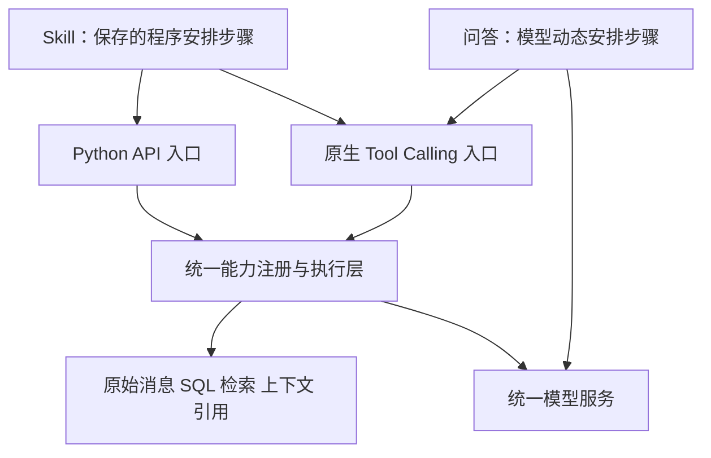
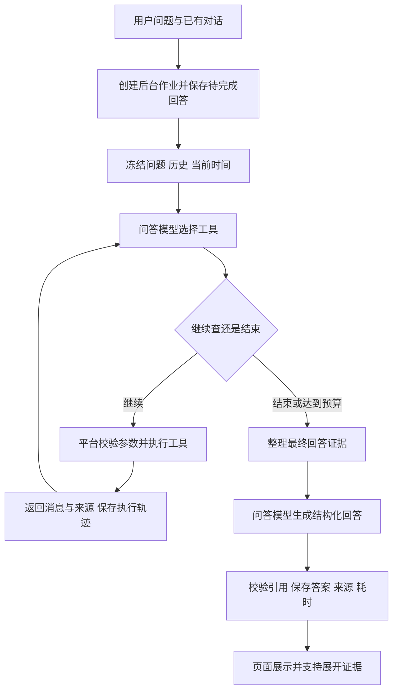
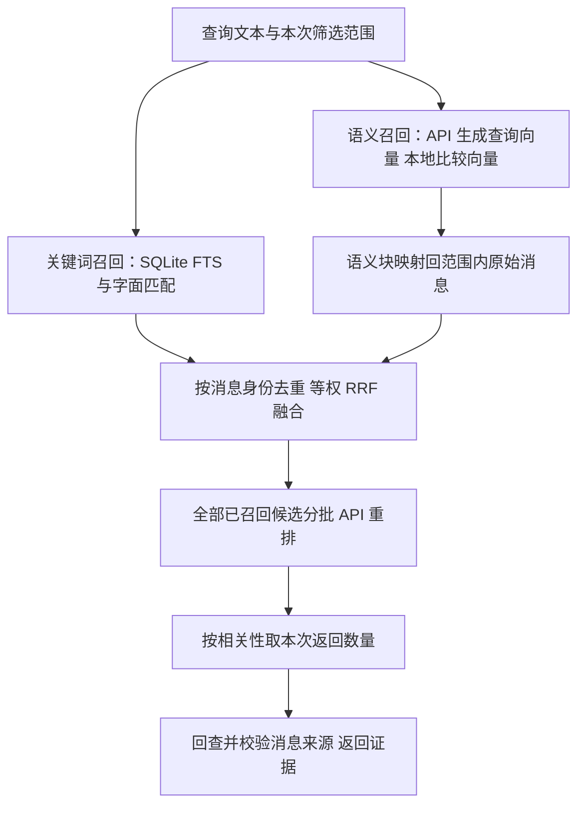
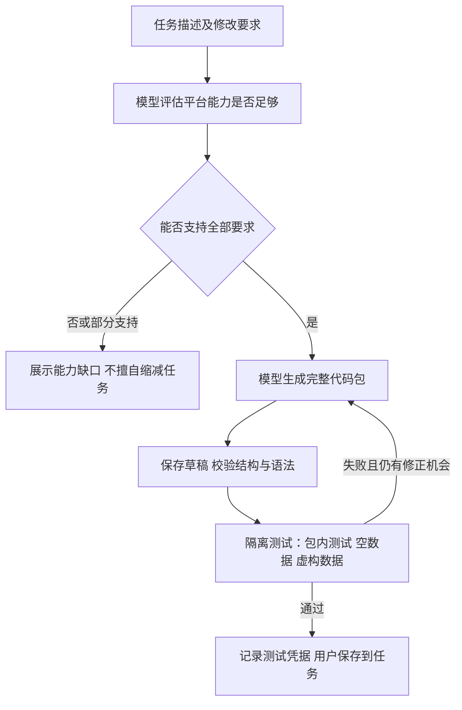
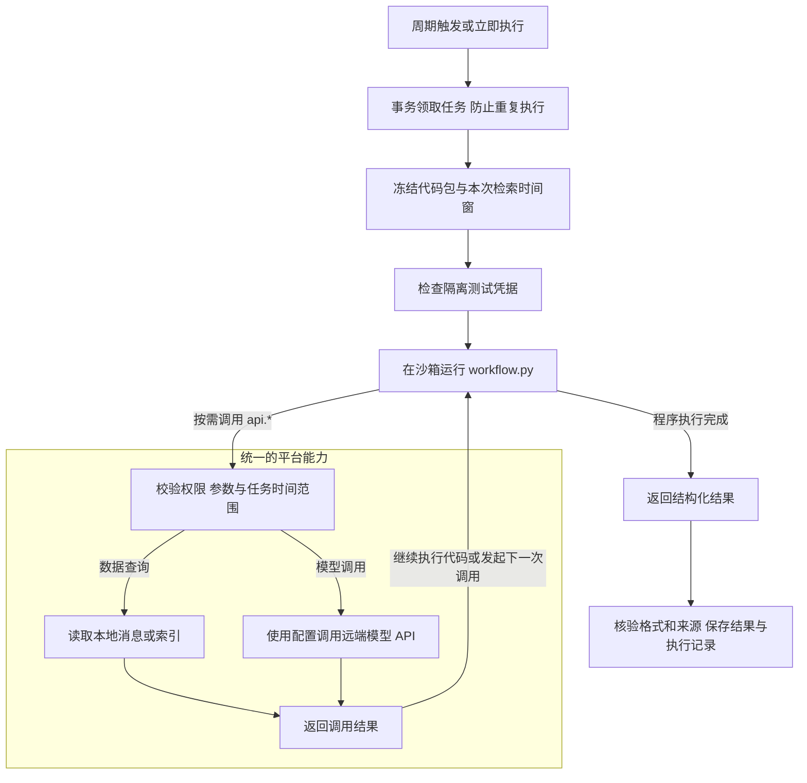

# WeChat Agent：问答与任务执行流程

更新：2026-10-13。本文描述统一平台能力后的当前代码，不包含已删除的旧执行方案。

## 1. 总览：谁决定下一步

**问答：模型边查边决定。任务：执行保存好的 Skill，由其中的程序决定。**

| | 聊天问答 | 任务助手 |
| --- | --- | --- |
| 触发 | 用户提问、继续追问 | 周期到期、立即执行 |
| 流程控制 | LangGraph 中的模型决策循环 | 任务自己的 `workflow.py` |
| 模型做什么 | 理解问题、选择工具、根据证据回答 | 创建时生成程序；执行时按程序要求分析或补查 |
| 是否每次生成代码 | 否 | 否，保存后重复执行，修改时再生成或编辑 |
| 是否每次调用模型 | 正常有证据的问答需要 | 不一定，纯规则任务可以不调用 |
| 时间范围 | 模型为每次工具调用选择条件，受数据边界约束 | 启动时冻结任务时间窗，程序不能越界 |
| 共用能力 | 人物、会话、检索、原始消息、只读 SQL、上下文、模型调用 | 同一实现，通过 Python API 或原生工具调用使用 |

当前技术实现是 **Python HTTP 服务 + LangGraph + SQLite + 原生 Tool Calling + 自建混合检索**，不是 LlamaIndex 或 Streamlit。



两边共用 `PlatformAPI` 和 `create_platform_runtime`。Python API 可返回完整结果，模型工具入口提供明确的分页与覆盖信息；不是分别维护两套查询实现。模型配置仍可分别选择“问答”和“任务”，统一服务不等于强制使用同一个模型。任务私有状态不暴露成跨任务共享状态，问答自身的对话与检查点由问答编排器管理。

## 2. 聊天问答：一次问题如何得到答案



### 2.1 先保存，再执行

前端通过后台作业接口提交问题。服务端先保存用户消息和待完成回答，然后执行 `run_qa_stream`。历史以服务端保存的会话为准，排除失败、未完成和已停止的回答。

本轮问题、历史和请求时间会冻结，因此中断恢复不会把原问题中的“今天”变成恢复当天。同一会话的执行受并发保护，页面切换不会取消服务端作业。

当前入口还会准备联系人索引、检查是否存在聊天内容，但**不会因此把问题限制到某几个联系人**。

### 2.2 不先填槽位，直接选择工具

图中的实际顺序是：

```text
初始化数据边界 → 模型决定 → 执行工具 → 模型决定 → …… → 生成答案
```

模型得到问题、近期问答历史、当前时间、已取得的证据和工具结果，直接返回原生 `tool_calls`。例如可以先查 NTU 相关群，再定位两个人，最后查他们在这些群里的消息和邻接上下文。

平台不再先用本地规则判断“美食问题”“最近问题”，也不维护全局人物、日期、主题槽位。人物和会话 ID 必须来自已经看到的工具结果；每步的筛选条件独立校验，不会无条件继承上一步的窄范围。

**没有全局槽位，不等于没有筛选条件。** 模型仍可以明确指定会话、人物、日期；这些是一次工具调用的参数，不是平台凭关键词提前锁定的路由。

### 2.3 多轮交互实际上怎么发生

```text
平台 → 模型：问题、历史、证据、工具定义
模型 → 平台：tool_call，例如 search(query=..., chat_ids=...)
平台：校验参数，在本机查询数据
平台 → 模型：带 tool_call_id 的工具结果
模型：继续补查，或调用 finish
```

远端模型不能直接读取本机数据库。每次都由平台发起 API 请求，再执行模型提出且通过校验的工具调用。

### 2.4 回答与引用

调用 `finish` 时，模型可以选择已取得的证据；与所选主证据关联的周边消息也会保留，然后共同接受最终上下文预算限制。

回答模型返回包含 `kind`、`text`、`source_refs` 的段落数据。平台校验格式及引用范围，前端用真实来源元数据展示会话、私聊或群聊类型、发送者、时间和原文，而不是让模型自行编造来源标签。

没有证据时返回“尚不能回答”，不将其解释成“相关消息不存在”。检索未穷尽或上下文被截断时保留限制说明。**引用编号有效只证明来源确实被检索到，不保证模型对原文的理解一定正确。**

最终答案、证据、检索过程和耗时更新到本轮 `turn_id`，不会用整个旧页面状态覆盖后来新增的对话。

## 3. 共用检索：search 内部做什么



1. **先应用范围。** 会话、人物和时间条件在各路召回时生效，语义块回查消息时再次过滤。不是全局取前 N 条后才筛指定群。
2. **多路召回。** Embedding API 只负责生成向量，相似度比较在本机完成；SQLite 提供全文和字面匹配补充。
3. **统一候选身份。** 语义块先映射回消息，与关键词命中的消息去重，保留其所属语义块作为重排参考。
4. **等权 RRF 融合。** 根据各路名次合并，不加美食词、推荐词或消息新旧等业务分数。
5. **API 重排。** 启用时，所有去重候选分批送给重排模型。没有先用本地业务打分截掉一批，再只重排剩余消息。
6. **返回消息证据。** 最后才按此次工具要求的数量返回，保留可核验的消息身份和诊断数据。

RRF 仍然产生本地顺序，但不承担业务判断：用于融合及重排同分时的稳定排序。Embedding 和 Rerank 是混合检索的必需配置，不再提供启停开关。重排批大小默认 48，是每次 API 请求的数量，不是所有候选的总上限。

“全部候选重排”不等于“全库所有消息重排”：语义、全文和字面召回本身仍有数量预算。问答和 Skill 的共享工具遇到语义或重排错误都会明确失败，不伪装成完整执行；独立检索调试器仍能显示底层 RRF 降级结果及错误。检索服务缺少配置时，共享 search 在准备索引或发起付费调用前明确报错。

### 三种上下文，不能混为一谈

| 上下文 | 怎么得到 | 用途 |
| --- | --- | --- |
| 问答历史 | 当前会话已保存的用户问题和助手回答 | 理解“她”“刚才那个”等追问，不是本轮事实证据 |
| 语义块上下文 | 向量命中块中的相邻聊天文本 | 帮助重排模型理解短消息，不能自动成为最终引用 |
| 消息前后文 | 调用 `surrounding`、`timeline` 等工具读取原文 | 进入证据工作集，可供最终分析和引用 |

**search 命中一条消息，不代表系统自动把它的全部聊天前后文交给回答模型。** 语义块中的一些消息可能同时成为候选，但若需要完整理解接话，仍应显式补查。

共享 `surrounding` 当前读取同会话、种子消息前后半小时内、各方向最多 3 条消息，遵守检索时间边界。它允许其他发送者出现，用 `context_for` 记录这些消息支持哪个主证据。需要更长上下文时，模型可以另用时间线工具查询。

## 4. 任务助手：生成和执行是两件事

### 4.1 创建或修改 Skill



生成模型得到任务需求、消息及索引结构、平台 API 和能力说明，**这个阶段不读取真实聊天**。生成与修正最多三轮。

| 包内文件 | 含义 |
| --- | --- |
| `workflow.py` | 完整执行程序，包括规则、查询、模型调用和结果整理 |
| `manifest.json` | 入口、权限、执行时间和调用预算 |
| `SKILL.md` | 面向人的流程说明 |
| `test_skill.py` | 包内测试 |
| `PLATFORM_API.md` | 平台接口契约，由平台提供 |
| `CAPABILITIES.json` | 生成时的平台能力评估报告 |

隔离测试用虚构消息和模拟模型，验证程序与平台接口能衔接，不代表真实任务效果已经通过人工评估。测试凭据绑定代码包、任务描述和运行时版本；修改后需要重新测试。

个性化规则保存在任务包里，不通过修改平台源码实现。平台仍需预先提供通用数据接口、安全约束和模型接口；“自定义 Skill”并不意味着生成代码可以任意访问电脑或网络。

### 4.2 周期到期或立即执行



以“每 6 小时运行，检索最近 1 天”为例，每次从启动时间向前取一天；手动执行也一样，**不是从上次成功时间开始增量裁切**。启用定时的任务手动执行后，会从本次启动时间重新计算下次运行时间。

当前任务助手全局串行，领取任务通过数据库事务保护。服务停止期间错过的周期合并为一次，不会恢复后无限补跑。

Skill 在 macOS 沙箱中运行，不能直接取得密钥、访问真实数据库文件或自行联网。`api.*` 调用通过受控通道交给宿主完成，再把结果返回程序。

图中的数据查询和模型调用都属于平台能力，由 Skill 按需选择，不要求每次都走模型分支。例如忘回私聊示例只调用数据接口，再用包内代码判断最后发送者，执行时不调用大模型。

**Skill 可以多轮调用模型，但不是平台替每个 Skill 自动循环。** 程序需要自己保存对话、调用 `api.llm`、处理 `tool_calls`、执行 `api.tool` 并回填工具结果；也可以完全不用模型。

## 5. 两种示例 Skill 的具体流程

以下以仓库中的示例包为准。任务中保存的包可以独立修改，不保证始终与示例文件相同。

### 5.1 忘回私聊：本地规则，不发送所有消息给模型

```text
列出时间窗内活跃会话
→ 筛选私聊
→ 每批最多 100 个会话，读取每个会话最后一条物理消息
→ 比较发送者身份与自己的账户身份
→ 对方发出且之后没有自己消息的，列为候选
→ 登记引用，返回结构化结果
```

读取原始消息而非全文索引，避免表情、通话等无普通正文的消息被忽略。身份或顺序无法确定时不能武断判断。

这里判断的是**消息顺序上的未回复候选**，不是语义上“必须回复”。寒暄、表情、通知是否需要回复，不能仅靠最后发送者证明。当前示例不调用模型，也不使用 Embedding。

代码：[忘回私聊示例](../examples/skills/unanswered/workflow.py)。

### 5.2 实习信息：召回、上下文、模型分析与补查

```text
以任务描述做语义召回 + 包内 SQL 关键词补召回
→ 按消息身份去重
→ 读取前后文并组成上下文窗口
→ 按窗口分批，给原文登记引用
→ 任务模型提取信息，必要时调用共享工具继续查
→ 校验输出和引用
→ 合并相同事实，保留更正或冲突信息
```

该包使用 `api.semantic_search` 加自己的 SQL，不是每一步都走共享混合 `search`。模型补查时可以使用共享 `search`，这时才进入前述混合召回与重排链。

当前示例前后文各取 3 条、最大间隔 30 分钟；按完整窗口组织不超过 30000 字符的批次。单窗口过大时明确失败，不静默截断。初始召回为空也会让模型尝试改写和补查，不能把工具错误当成“没有岗位”。

包中的实习关键词是**这个任务自己可编辑的规则**，不是平台检索器里的业务加分。当前示例也不是跨次执行的新消息去重器，滚动时间窗重叠时可能再次报告同一信息。

代码：[实习信息示例](../examples/skills/internships/workflow.py)。

## 6. 平台工具、索引与模型的分工

### 共用工具与 Skill 扩展接口

| 工具或接口 | 能力 |
| --- | --- |
| `find_people` / `list_chats` | 找人物与会话，获得可用的真实 ID |
| `search` | 范围内混合检索与 API 重排 |
| `timeline` / `surrounding` | 时间线、命中消息周边原文 |
| `shared_windows` | 查看多人共同出现的会话时间窗口，不等于证明互相对话 |
| `statistics` / `unanswered` | 索引统计、未回复候选查询 |
| `finish` | 结束本轮工具检索 |
| `read_chats/read_messages/read_messages_batch`；Python `api.chats/messages/messages_batch` | 同一原始会话和消息读取能力；原生工具按返回页纳入证据 |
| `query_messages`；Python `api.query` | 执行时间窗内的只读 SQL；可再用 since/until 缩小快照，聚合返回计算摘要而非原文 |
| `semantic_search`；Python `api.semantic_search` | 同一阈值语义查询；原生入口支持分页，不与混合 `search` 混淆 |
| `message_context`；Python `api.surrounding` | 同一可调条数及间隔的前后文能力，支持原始消息和索引消息 |
| Skill `api.llm/tools/tool` | 调模型、获取工具定义、执行共用工具 |
| Skill `api.cite` / 状态接口 | 登记真实来源、读取或暂存任务跨轮状态 |

共享工具里的 `evidence_id` 用来选择已取得的证据，最终结果的 `source_refs` 是展示用引用编号，不能直接混用。Skill 的 `api.cite` 负责核验来源并返回引用编号。

### 索引依赖按需准备

```text
同步聊天 + 已完成语音转写
          ↓
      全文消息索引
          ↓
      语义块与向量索引
```

Skill 只读原始消息时不要求先建索引。SQL 或共享索引工具会按需准备全文索引；语义查询还会准备语义索引。维护过程受锁保护，进度与索引 Embedding 用量单独记录。

问答现在复用同一套按需准备逻辑：读取原始消息不建索引，SQL 和索引工具准备全文索引，语义工具再准备向量索引。更新失败明确报错，两边不会各自采用不同的静默降级规则。

这也不等于每个任务都会自动同步微信、转写所有语音。任务读取当前已同步数据和已有转写；完整 RAG 更新链才按“语音转文字 → 全文索引 → 语义索引”执行。

### 模型配置

| 配置 | 使用处 |
| --- | --- |
| 语音模型 | 音频转文字 |
| 问答模型 | 问答工具决策、最终回答 |
| 任务模型 | 能力评估、Skill 生成与修正、Skill 执行中的 `api.llm` |
| Embedding | 索引向量、查询向量 |
| Rerank | 共用混合检索的候选相关性判断 |

查询向量、相关原文或音频会按对应 API 调用发送给配置的服务商。数据库本地保存，不等于所有推理都在本机执行。

## 7. 后台执行、停止与恢复

页面只负责提交与观察。切换 Tab、离开页面不会主动终止后台任务；但关闭服务、电脑休眠或网络失败会影响执行，它不是云端常驻服务。

显式停止是协作式取消：程序会在检查点停止，已经发出的远端请求不一定能撤销，也可能已产生费用。

| 持久化内容 | 作用 |
| --- | --- |
| 问答历史与任务执行记录 | 展示结果、来源、失败原因和耗时 |
| LangGraph 检查点 | 保存图执行状态与冻结输入 |
| 调用回执 | 复用已完成调用，避免恢复时重复请求模型 |

问答按图状态继续执行；Skill 中断后可能从程序入口重新运行，但按调用位置、方法和参数复用已完成回执。调用顺序变化会停止恢复。代码包或相关配置签名变化也不能接着旧快照运行。

问答协议已更新为 v6，检查点和工具回执同时保存共享平台的证据账本、用量与预算计数。此前协议的中断运行不能接着执行，但历史回答不删除。已保存的 Skill 包仍使用原 Python 接口，不需要因本次平台统一重新生成。

结果未知的可能计费调用，需要明确确认才能重试，不能假设超时就代表服务商没有执行。Skill 的跨轮状态只在整次成功后提交，失败不提交暂存状态。

默认保存位置是 `web_cache/qa_conversations.json`、`qa_checkpoints/`、`goals.sqlite3` 和 `goal_checkpoints/`；消息及向量索引在 `qa_messages.db`，联系人缓存是 `qa_index.pkl`。

## 8. 当前仍存在的边界

| 项目 | 当前行为 |
| --- | --- |
| 问答检索轮次 | 最多 8 次工具执行；重复相同动作会结束检索 |
| 问答时间预算 | 决策和工具入口检查 900 秒预算，不是到点强行取消远端请求 |
| 问答证据工作集 | 最终证据数量配置的 4 倍，最多 800 条 |
| 最终回答证据 | 配置限制在 10–200 条，单条最多 4000 字符，总正文最多 60000 字符 |
| 对话历史 | 工具决策最近 20 条、每条最多 8000 字符；最终回答最近 10 条、每条最多 2000 字符 |
| Skill 执行预算 | 由包的 manifest 指定；本地工具、模型与 Embedding 分别计数 |
| 额外重排请求 | Skill 共享 search 的后续批次和格式修正也消耗模型调用预算 |
| 平台 SQL | 同次执行、同一时间窗复用一个只读内存 SQLite；改变范围时替换，执行结束释放；问答和 Skill 的 Python/工具入口共用 |

这些是资源和安全边界，不是业务槽位或关键词加分。它们仍可能影响召回与覆盖，诊断和结果不能宣称无条件全量检查。评估效果需要结合实际工具轨迹、候选、引用原文和失败样例。

## 9. 按这个顺序读代码

| 阅读目的 | 文件与入口 |
| --- | --- |
| 问答接入与保存 | [web.py](../wechat_agent/web.py)：`run_qa_stream` |
| 问答多轮图 | [qa_agent.py](../wechat_agent/qa_agent.py)：`run_conversation_agent`、`_run_agent` |
| 共享工具协议与参数校验 | [platform_tools.py](../wechat_agent/platform_tools.py)：`parse_tool_call`、`execute_action` |
| 工具本地实现 | [qa_tools.py](../wechat_agent/qa_tools.py)：`ConversationTools` |
| 两种入口共用的 API | [platform_api.py](../wechat_agent/platform_api.py)：`PlatformAPI`；[platform_data_tools.py](../wechat_agent/platform_data_tools.py)：原生数据工具定义 |
| 统一数据与模型绑定 | [platform_runtime.py](../wechat_agent/platform_runtime.py)：`create_platform_runtime`、`PlatformModel`、`PlatformToolSession` |
| 混合检索与重排 | [web.py](../wechat_agent/web.py)：`search_qa_search_db`、`rerank_qa_items_with_config` |
| 任务调度与结果存储 | [goals.py](../wechat_agent/goals.py)：`observation_window`、`_claim`、`_execute` |
| Skill 生成、测试与恢复 | [code_skill_service.py](../wechat_agent/code_skill_service.py)：`generate_code_skill`、`validate_code_skill`、`run_code_skill` |
| Skill 绑定真实数据和模型 | [code_skill_web.py](../wechat_agent/code_skill_web.py)：`execute_code_goal` |
| Skill 包权限适配与沙箱 | [code_skill_api.py](../wechat_agent/code_skill_api.py) 将包权限交给共享 API；[code_skill_runtime.py](../wechat_agent/code_skill_runtime.py) 负责隔离执行 |

一句话记忆：**问答是“模型选工具，平台执行，模型再决定”；任务是“生成并保存程序，平台定时执行，程序按需找模型”。两者共用数据能力，但流程控制权不同。**
